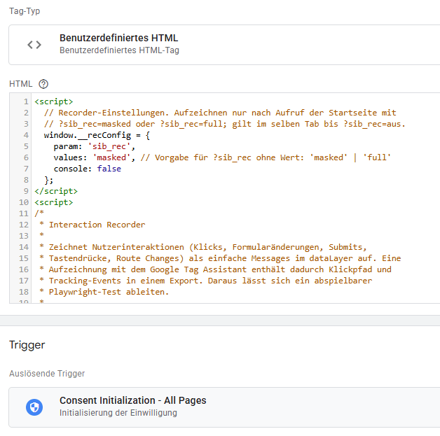
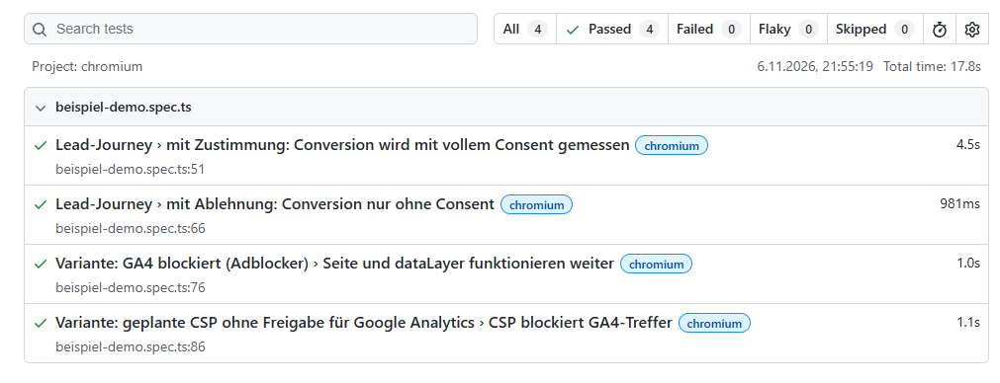

# Stage in a Box

**Tracking-Tests für Websites, ohne eigene Testumgebung und ohne selbst Tests zu programmieren: Du zeichnest einen Ablauf einmal auf, ein Coding-Agent baut daraus eine Testsuite.**

CMP, Consent Mode, GTM, serverseitiges Tagging, CSP – moderne Tracking-Setups bestehen aus vielen Teilen, die sauber zusammenspielen müssen. Nach jedem Deployment, jeder CMP-Änderung oder jedem neuen Tag per Hand durch den Kaufprozess zu klicken, reicht dafür nicht mehr. Automatisierte Tests scheitern bisher meist daran, dass sie jemand schreiben muss, der sowohl Tracking als auch Testautomatisierung versteht.

Dieses Repo verkürzt den Weg: Ein GTM-Tag zeichnet beim Durchklicken alles auf, was ein Agent für den Nachbau braucht. Ein Analyse-Script macht daraus eine lesbare Zeitleiste und einen Auftragsentwurf. Das Repo liefert die fertige Testumgebung, eine Anleitung sagt dem Agent, wie aus allem Tests werden. Jede Website wird darin ein eigenes Projekt; Umgebung, Anleitung und alles, was der Agent dabei lernt, teilen sich alle Projekte.

## Was Du davon hast

Ist die Journey einmal als Test angelegt, wird sie zur **Stage in a Box**. Du kannst sie unter beliebigen Bedingungen laufen lassen:

- **Gegen eine Baseline vergleichen:** Der erste Lauf speichert den Ist-Zustand – dataLayer, Consent, alle Requests an Tracking-Dienste inklusive Weiterleitungen. Jeder weitere Lauf meldet Abweichungen, etwa nach einem Deployment.
- **Requests prüfen, ohne dass sie gesendet werden.** Requests an GA4, Google Ads, Meta & Co. werden abgefangen und protokolliert. Das funktioniert auch auf Live-Seiten ohne Staging.
- **Dienste gezielt blockieren**, wie es ein Adblocker täte, und prüfen, ob Seite und Conversion-Tracking trotzdem funktionieren.
- **Consent-Varianten durchspielen**, ohne die CMP umzukonfigurieren.
- **Ladereihenfolgen simulieren**, etwa GTM oder CMP verzögert, um Race Conditions aufzudecken.
- **Eine geplante CSP testen**, bevor sie live geht, inklusive der Frage, ob sie im Kaufabschluss Tracking blockiert.
- **Änderungen im GTM-Workspace testen**, bevor sie veröffentlicht werden: Die Tests laufen dann über die GTM-Vorschau statt gegen den Live-Container.
- **Im Tempo eines Menschen** oder exakt im Tempo der Aufzeichnung, damit auch zeitabhängige Requests wie `user_engagement` entstehen.
- **Optional mit Proxy**, der wirklich alles im Netzwerk sieht und steuert: auch Beacons beim Verlassen einer Seite und Requests aus Service Workern.

## So läuft es ab

```
 1. Recorder-Tag im GTM anlegen         (einmalig, 5 Minuten)
 2. Journey im Preview durchklicken      → Tag-Assistant-Export
 3. Projekt anlegen, Agent: Analyse      → auftrag.md, Liste für .env, ggf. Testdaten
 4. Du: Auftrag prüfen, .env ausfüllen   → Status „bestätigt“
 5. Agent: Tests bauen                   → Testsuite, bis vor die Conversion stabil,
                                           dann ein vollständiger Lauf
 6. Agent: Baseline ziehen               → Ist-Zustand als Vergleichsbasis
 7. Tests laufen lassen                  (jederzeit, mit Varianten, nach jeder Änderung)
```

Dein Beitrag ist die Aufzeichnung, ein prüfender Blick auf den Auftrag und das Eintragen der Testdaten. Den Rest erledigt der Agent. Ab Schritt 6 meldet der Baseline-Vergleich jede Änderung am Setup, auch solche, an die beim Schreiben der festen Erwartungen niemand gedacht hat.

## Voraussetzungen

- Zugriff auf den GTM-Container der Website (Preview reicht; ohne GTM siehe [Ohne GTM](#ohne-gtm))
- [Node.js](https://nodejs.org/) ab Version 20.12
- Ein Coding-Agent, z. B. [Claude Code](https://claude.com/claude-code)

## 1. Recorder-Tag einrichten

1. Neues Tag vom Typ **Benutzerdefiniertes HTML** anlegen und den Inhalt von [`dist/gtm-recorder-tag.html`](dist/gtm-recorder-tag.html) einfügen.
2. Trigger: **Consent Initialization – All Pages**.
3. Speichern. Veröffentlichen ist nicht nötig, schadet aber auch nicht: Das Tag zeichnet nur auf, wenn die Seite mit dem Parameter `sib_rec` aufgerufen wurde. Für alle anderen Besucher bricht es sofort ab; es kostet dann nur die rund 16 KB im Container.



Der Wert des Parameters bestimmt, wie Eingaben in Formularen aufgezeichnet werden:

- `?sib_rec=masked` (auch `?sib_rec` ohne Wert): nur Format und Länge, z. B. `Xxx.Xxxxxxxxxx@xxxxxxx.xx`.
- `?sib_rec=full`: Eingaben im Klartext. Nötig, wenn Hashing oder Enhanced Conversions geprüft werden sollen, und praktisch, weil die Eingaben dann direkt als Testdaten übernommen werden können (siehe [4.](#4-auftrag-prüfen-und-env-ausfüllen)). Dann nur mit Testdaten aufzeichnen.
- `?sib_rec=aus` beendet die Aufzeichnung im Tab.

Die Aufzeichnung gilt ab dem Aufruf mit Parameter für alle folgenden Seiten im selben Tab (über `sessionStorage`) und endet, wenn der Tab geschlossen wird. Passwörter und Kartendaten werden in keinem Modus aufgezeichnet.

Das Tag schreibt seine Einträge als Messages ohne Event in den dataLayer. Der Tag Assistant zeigt sie als „Nachricht“. Für GTM selbst sind sie unsichtbar: Es werden keine Trigger ausgewertet, und kein vorhandenes Tag kann dadurch auslösen.

## 2. Journey aufzeichnen

1. **Frisch starten:** Cookies und Website-Daten der Seite löschen oder ein neues Inkognito-Fenster verwenden, damit der Consent-Banner erscheint.
2. **Preview starten** und die Website im Tag Assistant mit Parameter öffnen, z. B. `https://www.example.de/?sib_rec=full`. Der Parameter wird bei der Analyse aus der Startadresse entfernt.
3. **Den Ablauf einmal vollständig durchklicken**, inklusive Consent-Banner, so wie ein normaler Besucher. Ohne Umwege, ohne Neuladen, ohne parallele Tabs. Dein Tempo wird mit aufgezeichnet und kann später nachgespielt werden.
4. Bei einem Kauf: nur mit Testkonto, Testprodukt, Gutschein oder Testzahlart, und nur wenn das abgesprochen ist.
5. Im Tag Assistant die Aufzeichnung **exportieren**.

**Wenn GTM erst nach der Zustimmung lädt:** Dann läuft auch der Recorder erst danach, und der Klick auf den Consent-Banner fehlt in der Aufzeichnung. Trag in diesem Fall im Auftrag unter „Consent-Banner“ ein, wie der Banner bedient wird: entweder den Namen der CMP (der Agent sucht die Selektoren dann in der CMP-Bibliothek des [Tracking Auditor](https://github.com/mbaersch/tracking-auditor)) oder die Selektoren selbst, z. B. `a.consentlink` für Zustimmen und `a.noconsentlink` für Ablehnen. Nenne auch Schritte, ohne die der Banner nicht erscheint, etwa „erst nach Scrollen sichtbar“. Dasselbe gilt für Banner in einem iframe oder geschlossenen Shadow DOM, in die der Recorder nicht hineinsieht. Die Analyse weist auf solche Fälle hin.

Tipp: Lieber mehrere kurze Aufzeichnungen (z. B. „Consent akzeptieren + Kauf“ und „Consent ablehnen + Kauf“) als eine lange mit allem.

## 3. Projekt anlegen und Analyse starten

Einmalig im Hauptordner des Repos:

```sh
npm install
npx playwright install chromium
```

Dann pro Website ein Projekt:

```sh
npm run neu -- mein-shop
```

Das legt `projects/mein-shop/` mit Auftrag, `projekt.md`, `.env` und leeren Ordnern an. Abhängigkeiten werden dort nicht noch einmal installiert. `projects/` ist von Git ausgeschlossen. Trag `BASE_URL` in `projects/mein-shop/.env` ein, leg den Export nach `projects/mein-shop/aufzeichnungen/` und starte den Agent **im Hauptordner**, zum Beispiel mit:

> Projekt mein-shop: Analysiere die Aufzeichnung und fülle den Auftrag vor.

Die Session gehört immer in den Hauptordner, nicht in den Projektordner. So hat der Agent bei jedem Projekt dieselbe Anleitung und dieselben Erinnerungen, und was er bei einem Projekt lernt, steht beim nächsten zur Verfügung. Was nur eine Website betrifft, hält er in `projects/<name>/projekt.md` fest.

Der Agent ruft dafür `npm run analyse -- projects/mein-shop/aufzeichnungen/<datei>` auf. Das Script erzeugt neben dem Export eine Zeitleiste (`.zeitleiste.md`) mit allem, was passiert ist: Aktionen, Events, Consent, gefeuerte Tags, Google-Requests, Auffälligkeiten und bereits fertige Playwright-Schritte. Du kannst die Zeitleiste auch selbst lesen; sie ist oft schon für sich ein guter Überblick über ein Setup.

## 4. Auftrag prüfen und `.env` ausfüllen

Der Agent füllt den [Auftrag](vorlage/auftrag.md) vor und markiert alles Abgeleitete mit *(aus Aufzeichnung)*. Du prüfst:

- Stimmt die **Conversion-Aktion**? Was muss passieren, was darf auf keinen Fall passieren?
- Gibt es ein **Testkonto**, dessen Bestellungen automatisch storniert werden? Ist ein echter Kauf erlaubt?
- Soll eine **Baseline** angelegt werden, und in welchem **Tempo**?
- Welche **Varianten** willst Du (Consent abgelehnt, Dienst blockiert, CSP …)?
- Ist eine **GTM-Vorschau** nötig, weil das zu Testende nur in einem Workspace oder einer Umgebung existiert?

Dann setzt Du oben den Status auf **bestätigt**.

**`.env` füllst nur Du aus.** Der Agent schreibt sie nie und gibt ihre Werte nicht aus. Er trägt die nötigen Variablennamen in `.env.example` ein (z. B. `TEST_LOGIN_EMAIL`, `TEST_LOGIN_PASSWORT`, `TEST_VORNAME`) und sagt Dir, was fehlt. Die Tests lesen die Werte zur Laufzeit.

**Testdaten aus der Aufzeichnung:** Wurde mit `?sib_rec=full` aufgezeichnet, bietet der Agent an, die Eingaben 1:1 zu übernehmen. So gibst Du die Testdaten nur einmal ein, beim Aufzeichnen. Das Analyse-Script (`--testdaten`) schreibt sie nach `projects/<name>/testdaten.aufzeichnung.env`; `.env` bleibt unberührt und hat Vorrang. Willst Du einen Wert ändern, trägst Du ihn einfach in `.env` ein. Passwörter fehlen dort immer, weil der Recorder sie nie aufzeichnet.

Werte stehen direkt hinter dem `=`. Leer gelassene Einträge gelten als nicht gesetzt, dann greift die Vorgabe. Steht ein Wert in einer Zeile mit `#` davor, wirkt er nicht; der Testlauf warnt dann mit dem Namen der Variable.

**Tests gegen die GTM-Vorschau:** Den Link holst Du in GTM über *Vorschau* bzw. *Vorschau teilen*. Er enthält `gtm_auth` und `gtm_preview` und damit einen Zugangsschlüssel, deshalb gehört er als `GTM_VORSCHAU_LINK` in `.env`. Ein Tag-Assistant-Link mit nur `gtm_debug` startet keine Vorschau des Workspaces. Die Tests öffnen den Tag Assistant, starten die Verbindung und laufen im neuen Tab mit der Website weiter.

## 5. Tests bauen lassen

> Projekt mein-shop: Der Auftrag ist bestätigt. Baue die Tests.

Der Agent richtet die Tests mit `CONVERSION=aus` ein: Sie laufen bis direkt vor den Kauf bzw. das Absenden, es wird also nichts Echtes ausgelöst. Erst wenn das stabil läuft, folgt ein vollständiger Lauf mit Conversion. Danach berichtet er: welche Tests es gibt, welche Erwartungen er aus dem Ist-Zustand übernommen hat (zur Bestätigung), Auffälligkeiten, offene Punkte und was er in `projekt.md` festgehalten hat.

Die Anweisungen für den Agent stehen in [`AGENTS.md`](AGENTS.md). Claude Code liest sie über `CLAUDE.md` automatisch ein, andere Agents über `AGENTS.md`.

## 6. Baseline ziehen

> Projekt mein-shop: Zieh die Baseline.

Sobald der vollständige Lauf grün ist, speichert der Agent den Ist-Zustand als Baseline: alle Requests, Consent-Parameter und dataLayer-Events der Journey. Direkt danach gleicht er sie mit einem zweiten Lauf ab. Der zeigt, was sich ohne jede Änderung am Setup unterscheidet: Zufalls- und Zeitwerte, Begleit-Requests, deren Anzahl schwankt (z. B. Cookie-Abgleich bei Google Ads), und Rauschen wie Sitzungsaufzeichnungen. Der Agent ordnet jede Abweichung ein und wiederholt den Abgleich, bis kein Rot mehr bleibt und nur noch erklärbare Hinweise. Erst dann ist die Baseline fertig. Ab dann meldet jeder Lauf Abweichungen, etwa nach einer Änderung im GTM. Baseline-Läufe senden echte Requests, auch Conversions (siehe [Baseline](#baseline)).

## 7. Tests ausführen

Alle Befehle im Hauptordner; das Projekt ergibt sich aus dem Pfad:

```sh
npm test -- projects/mein-shop                            # alle Tests, unsichtbar
npm run test:sichtbar -- projects/mein-shop               # mit sichtbarem Browser
npx playwright test projects/mein-shop/tests/kauf.spec.ts # eine Datei
npm run report -- projects/mein-shop/playwright-report    # HTML-Report öffnen
npm run baseline:neu -- projects/mein-shop                # Baselines bewusst neu erstellen
TEMPO=aufzeichnung npm test -- projects/mein-shop         # im Tempo der Aufzeichnung
PROXY=ein npm test -- projects/mein-shop                  # über den Proxy (siehe unten)
```

Solange Tests eingerichtet werden, laufen sie mit `CONVERSION=aus` (in `.env` oder vor dem Befehl) nur bis direkt vor den Kauf bzw. das Absenden und gelten dann als übersprungen. So wird beim Ausprobieren nichts Echtes ausgelöst; die Conversion selbst prüft erst der vollständige Lauf.

Pfade immer mit `/` schreiben, auch unter Windows: Playwright liest sie als regulären Ausdruck, ein `\` findet keine Tests. Statt über den Pfad lässt sich das Projekt auch mit `PROJEKT=mein-shop` wählen. Unter Windows oder dauerhaft: `TEMPO`, `PROXY` und `TRACKING_MODUS` in der `.env` des Projekts setzen.



Der Report enthält zu jedem Test den kompletten dataLayer, alle Tracking-Requests, die angefragten Hosts, Requests ohne Regel und ggf. CSP-Verstöße als Anhang. Dieselben Dateien liegen auch in `projects/<name>/test-results/<test>/`. So lässt sich auch ohne erneutes Durchklicken nachvollziehen, was passiert ist. Bei Tests über die GTM-Vorschau fehlen dort der dataLayer und die eigenen GA4-Requests des Tag Assistant: Die Anhänge zeigen nur die Website.

**Requests ohne Regel** werden nur protokolliert, nie abgefangen. Kennt keine Regel einen Tracking-Endpunkt, geht er also auch im Modus „abfangen“ echt raus. `UNBEKANNTE=abfangen` behandelt deshalb auf Wunsch alle Fetch-, XHR- und Beacon-Requests an fremde Domains wie Tracking; das kann aber Funktionen der Website stören.

### Baseline

Baseline-Tests laufen immer mit **echten Requests**. Nur dann entstehen Weiterleitungsketten (z. B. bei Google-Ads-Conversions) und Folge-Requests, die ein Server-Container auslöst. Plane deshalb ein, wie Testtraffic erkannt oder gefiltert wird (Testkonto, IP-Filter o. Ä.).

Der erste Lauf speichert `projects/<name>/baselines/<journey>.json`. Jeder weitere vergleicht dagegen und legt einen Bericht `baseline-vergleich.md` in den Report.

| Rot – Test schlägt fehl | Nur Hinweis im Bericht |
|---|---|
| Request fehlt, ist mehrfach da, wurde blockiert oder scheiterte | neue Requests eines bekannten Dienstes |
| neuer Dienst, der in der Baseline gar nicht vorkam (z. B. nach Rollback oder durch ein fremdes Tag) | neue Domains und neue Requests ohne Regel (eigener Abschnitt „Neu im Netzwerk“) |
| Consent-Parameter geändert (`gcs`, `gcd`, `npa`, `dma`) | neue oder geänderte Request-Parameter |
| dataLayer-Event fehlt oder ist mehrfach da | neue Events, neue Keys |
| Key fehlt, der in der Baseline vorhanden war | geänderte Werte außerhalb von `ecommerce`; neue oder weggefallene Requests ohne Regel |
| jede Abweichung in `ecommerce` (z. B. `item_id`, `item_category`) | geänderte Reihenfolge der Events |
| Consent-Befehle geändert, CSP-Verstoß | |

Werte, die sich bei jedem Lauf ändern (Transaktions-IDs, Session-IDs, Zeitstempel), werden nur auf Vorhandensein geprüft. Gängige sind hinterlegt, weitere trägt der Agent ein.

Bei zwei Arten von Requests schwankt die Anzahl auch ohne jede Änderung am Setup. Sie stehen im Bericht mit eigener Kennzeichnung, und eine abweichende Anzahl ist nur ein Hinweis. Geänderte Consent-Parameter bleiben auch dort rot.

- **(Timing):** hängen davon ab, wie lange jemand auf einer Seite bleibt, etwa GA4 `user_engagement` und Heartbeats von Matomo/Piwik PRO.
- **(Begleit):** Cookie-Abgleich, Kopien und Weiterleitungen, die Dienste mal senden und mal nicht (z. B. Google Ads über `ccm` und `1p-conversion`), sowie Uploads von Sitzungsaufzeichnungen wie Clarity.

Baseline und Vergleich laufen immer im selben **Tempo**. Am Ende verlässt der Test die letzte Seite, damit auch Requests beim Verlassen in der Baseline stehen.

### Tempo

| `TEMPO` | Verhalten |
|---|---|
| `schnell` (Vorgabe) | keine Pausen – für die Entwicklung und schnelle Prüfungen |
| `mittel` | 1,5 s zwischen den Schritten, leicht verlangsamte Aktionen |
| `langsam` | 4 s zwischen den Schritten, deutlich verlangsamte Aktionen |
| `aufzeichnung` | Pausen genau wie in der Aufzeichnung (höchstens 60 s pro Schritt) |

Manche Requests hängen von der Verweildauer ab, etwa GA4 `user_engagement`, Timer- oder Scroll-Trigger. Im Tempo `schnell` fehlen sie oder sehen anders aus.

### Proxy

Ohne Proxy beobachtet und steuert die Testumgebung Requests über Playwright. Das reicht für die meisten Fälle und hat zwei blinde Flecken:

- **Beacons beim Verlassen einer Seite** (GA4 `user_engagement`, Microsoft Ads und viele andere senden bei `pagehide`) sieht Playwright nicht und kann sie nicht abfangen. Sie werden über das Netzwerkprotokoll des Browsers nachträglich erkannt, aber ohne Inhalt. Im Modus „abfangen“ gehen sie trotzdem raus.
- **Service Worker** müssen abgeschaltet werden, sonst entgehen deren Requests der Kontrolle. Das ist weniger realistisch als ein echter Besuch.

Mit `PROXY=ein` (in `.env`) laufen alle Requests des Testbrowsers über einen lokalen Proxy. Der sieht jeden Request mit Inhalt, kann ihn abfangen, blockieren oder verzögern, auch auf Pfaden der eigenen Domain (sGTM). Service Worker laufen dann wie bei echten Besuchern.

Dafür bricht der Proxy HTTPS mit eigenen Zertifikaten auf, denen nur der Testbrowser vertraut. Zwischen Browser und Proxy gilt HTTP/1.1. Für Tracking-Tests spielt das keine Rolle, bei Performance-Messungen schon. Mit Proxy entstehen eigene Baselines (`<journey>.proxy.json`). Der Proxy braucht eine zusätzliche Abhängigkeit (`node-forge`, wird mit `npm install` installiert).

### Ausprobieren ohne eigene Website

Das Repo bringt in `beispiel/` eine kleine Demo-Seite mit Consent-Banner, Seitenwechsel, Conversion-Button und einem simulierten Server-Container mit. `npm test` ohne Projekt lässt die Beispieltests dagegen laufen:

```sh
npm install && npx playwright install chromium && npm test
```

Für eine erste echte Aufzeichnung eignet sich [atomkraftwerke24.de](https://atomkraftwerke24.de/), ein WooCommerce-Demoshop, in dem Bestellungen nicht ausgeführt werden.

## Ohne GTM

[`dist/recorder.js`](dist/recorder.js) ist dieselbe Aufzeichnung als eigenständiges Script. Es kann per DevTools *Local Overrides*, als Snippet oder über eine Browser-Extension eingebunden werden, die Scripts in Seiten einspielt. Es schreibt jeden Eintrag zusätzlich in die Konsole. Mit aktiviertem *Preserve log* bleibt die Aufzeichnung über Seitenwechsel erhalten und lässt sich als Datei speichern. Das Analyse-Script liest auch diesen Mitschnitt; Events, Tags und Requests fehlen dann aber.

## Grenzen

- **Inhalte in fremden iframes** (Zahlungsfelder, manche Consent-Banner) kann der Recorder nicht sehen. Der Agent muss diese Schritte anders lösen oder fragt nach.
- **Requests anderer Dienste als Google** stehen nicht im Tag-Assistant-Export, nur dass ihr Tag gefeuert hat. In den Tests werden sie trotzdem vollständig erfasst.
- **Ohne Proxy:** Beacons beim Verlassen einer Seite (z. B. `user_engagement`) laufen in Chromium am Abfangen vorbei. Im Modus „abfangen“ werden sie deshalb echt gesendet. Die Tests erkennen das und markieren sie als „entwischt“. Mit Proxy passiert das nicht.
- **Eigene Pfade und Formate:** Tracking über Pfade der eigenen Domain, Custom Loader oder getunnelte Requests erkennen die Standardregeln nicht. Solche Requests erscheinen als „Requests ohne Regel“. Der Agent prüft sie vor dem Bauen und legt passende Regeln an.
- **Hover-Menüs**, die sich nur bei Mouseover öffnen, werden nicht aufgezeichnet.
- **Bot-Schutz, Captchas und 3-D-Secure** können automatisierte Abläufe stoppen. Die Testumgebung verbirgt die Automatisierung des Browsers, weil manche CMPs (z. B. Usercentrics) einem erkannten Bot sonst selbst Consent erteilen. Das sähe aus wie Tracking ohne Zustimmung.
- **Serverseitiges Tagging:** Geprüft wird, was der Browser an den Server-Container schickt und was dieser im Browser auslöst, nicht was er serverseitig weitersendet.

## Datenschutz

- Im Modus `full` enthält der Export echte Eingaben. Nur mit Testdaten aufzeichnen.
- `projects/` ist komplett von Git ausgeschlossen. Bekommt ein Projekt ein eigenes Repo, schließt dessen `.gitignore` Aufzeichnungen, `.env` und `testdaten.aufzeichnung.env` aus. Baselines enthalten Request-Parameter und damit ggf. gehashte Testdaten.
- Tests mit festen Erwartungen senden keine Tracking-Daten (ohne Proxy bis auf die oben genannten Beacons). Baseline-Tests senden echte Requests.

## Aufbau

```
AGENTS.md                 Anweisungen für den Agent (für alle Projekte)
CLAUDE.md                 bindet AGENTS.md für Claude Code ein
lib/                      die Testumgebung: stage, baseline, tempo, netlog, proxy
werkzeuge/                Analyse-Script, Anlegen neuer Projekte
docs/                     Aufzeichnungsformat
beispiel/                 Demo-Seite mit Beispieltests und Baselines
vorlage/                  Gerüst für neue Projekte (npm run neu)
projects/                 Deine Projekte, nicht in Git
  <name>/
    projekt.md            Anweisungen und Erkenntnisse nur für dieses Projekt
    auftrag.md            Auftrag (vom Agent vorausgefüllt, von Dir bestätigt)
    .env                  Zugangs- und Testdaten (nur Du)
    testdaten.aufzeichnung.env   optional: Eingaben aus der Aufzeichnung
    aufzeichnungen/       Exporte und Analysen
    tests/ baselines/     Tests und Baselines
dist/
  gtm-recorder-tag.html   Inhalt für das GTM-Tag
  recorder.js             eigenständige Variante (ohne GTM)
src/
  recorder-core.js        Quellcode des Recorders (hier ändern, dann build.sh)
test/                     Smoke-Test für den Recorder
```

## Verwandtes Projekt

[Tracking Auditor](https://github.com/mbaersch/tracking-auditor) – automatisierte Audits von Tracking-Setups in verschiedenen Consent-Zuständen. Der Agent nutzt ihn in schwierigen Fällen als Referenz: die CMP-Bibliothek mit Selektoren für über 120 Consent-Banner, die Dienste-Datenbank und die Erkennung von Tracking über eigene Pfade und getunnelte Formate.

## Entwicklung

```sh
sh build.sh                 # dist/ aus src/recorder-core.js erzeugen
npm run test:recorder       # Smoke-Test des Recorders
npm test                    # Beispieltests gegen die Demo-Seite
npm run pruefen             # TypeScript-Prüfung, auch aller Projekte
```

Die Versionen sind über `package-lock.json` festgelegt und mit den Beispieltests geprüft. Aktualisieren mit `npm update` und danach `npx playwright install chromium`, dann die Beispieltests laufen lassen.

Die `.gitignore` im Hauptverzeichnis lässt nur die bekannten Ordner und Dateien zu und schließt `projects/` ausdrücklich aus. So gelangen keine Aufzeichnungen oder Baselines aus eigenen Tests ins öffentliche Repo.

## Lizenz

[MIT](LICENSE) – Nutzung, Änderung und Weitergabe frei, auch kommerziell. Bedingung ist nur, dass der Lizenzhinweis erhalten bleibt.
